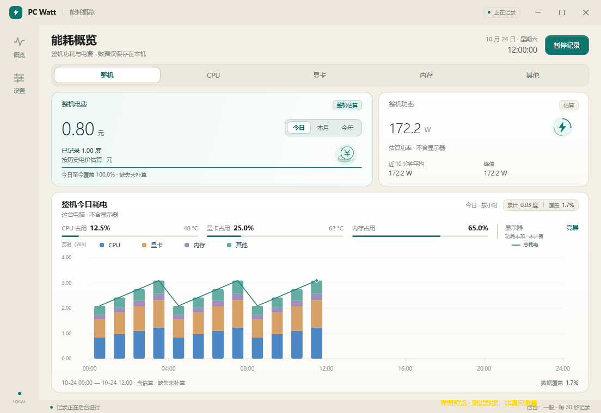

# PC Watt

**看清电脑用了多少电，花了多少钱。**

PC Watt 是一个面向 Windows 的开源功耗与电费查看器。填写自己的人民币电价后，就能查看已记录用电对应的今日、本月和今年估算电费，也能切换 CPU、显卡、内存和其他部件的耗电图表。

本地保存，无账号、无广告，不上传使用记录。界面保持简单，关闭后留在托盘继续记录。

**[下载安装包](https://github.com/yan450863-ui/PCWatt/releases/tag/v0.1.0)** · [问题反馈](https://github.com/yan450863-ui/PCWatt/issues) · [使用说明](docs/INSTALLATION.txt)

当前版本：**0.1.0 公开预览版**。Windows 10 1809+ / Windows 11，x64。安装包已包含 .NET 10，不用额外安装运行环境；Windows 10 和不同硬件仍需更多实机验证。



*界面预览使用明确标注的测试数据，下载版本会尝试读取本机可用硬件。*

## 它能做什么

- **把电费放在首页**：今日、本月、今年一键切换，显示已记录电量及估算费用。
- **看清哪些部件在用电**：整机、CPU、显卡、内存、其他五项切换；整机图按硬件分色，悬停查看各部件耗电。
- **顺手看看温度和占用**：显示 CPU / 显卡温度，以及 CPU / 显卡 / 内存占用率；读不到时保持未知。
- **托盘后台记录**：关闭窗口释放界面，点开重新加载；鼠标悬浮托盘图标查看整机功率和温度。
- **四档记录模式**：精细 5 秒、细 10 秒、一般 30 秒、省电 1 分钟，默认一般。
- **按自己的电价算钱**：设置人民币元/度和生效日期，保留电价历史。
- **看显示器状态**：亮屏、熄屏或调暗；功耗未知时不计费。

## 开始使用

1. 在 [Releases](https://github.com/yan450863-ui/PCWatt/releases) 下载 `PCWatt-0.1.0-Setup-win-x64.exe`，双击安装。
2. 打开 PC Watt，在设置里填写自己的电价（元/度）。
3. 等待可用硬件读数并开始记录。需要完全退出时，从右下角托盘菜单选择“退出”。

安装本身不需要管理员权限。默认启用登录自启动和启动时请求完整硬件读取，可分别在设置中关闭；完整硬件读取使用正常 Windows UAC 授权，取消后仍可记录可用项目。

也提供 `PCWatt-0.1.0-win-x64.zip`：解压完整目录后运行 `PCWatt.App.exe`。它同样使用本地用户数据目录，不是数据随 U 盘移动的便携模式。不要只复制 EXE 而丢掉其余文件。

当前安装包未作代码签名，Windows 可能显示“未知发布者”或信誉提示。请认准本仓库 Releases，并使用附件 `SHA256SUMS.txt` 核对下载内容。

## 数值代表什么

**PC Watt 当前的整机功率是估算，不是墙插功率计实测。** 软件优先使用可用的硬件瓦数读数，缺失部件采用明确标注的通用估算，再计入估计电源损耗。不包含显示器，也不代表电力公司的整户账单。

- CPU / 显卡能否读取取决于设备、现有驱动接口与权限。管理员权限不保证读数可用；本版本不安装内核驱动。
- 没有内存功率传感器时，内存采用系统合计 **8 W 通用估算**；占用率是独立数据，不用于换算瓦数。
- 图表显示记录到的有效区间。暂停、休眠或长时间缺失不补零、不用当前功率追算，已记录费用不等于全天完整费用。
- 显示器状态来自 Windows 当前会话，不保证实体电源键或多屏逐台识别；没有可靠瓦数时不加入耗电或电费。

当前尚不包含任意历史日期选择、小时/周独立视图、CSV/JSON 导出、备份恢复界面或外部功率计接入。

## 数据与隐私

设置、电价、历史记录默认保存到 `%LOCALAPPDATA%\PCWatt`，启动诊断也只写本地。日常运行不要求联网，没有账号系统和遥测上传。升级前请从托盘退出旧版；卸载默认保留历史记录与电价。[隐私说明](docs/PRIVACY.md)

## 开发与许可

技术栈：C#、WPF、.NET 10、MVVM、SQLite；使用 LibreHardwareMonitor 读取可用硬件信息。

```powershell
dotnet restore PCWatt.sln --locked-mode
dotnet build PCWatt.sln -c Release --no-restore
dotnet test PCWatt.sln -c Release --no-build --no-restore
```

- `src/`：App、Core、Infrastructure、Launcher。
- `tests/`：积分、计费、持久化、硬件选择、生命周期与渲染测试。
- `packaging/`：EXE 安装包构建与 GitHub 发布工具。
- `docs/`：使用说明、[开发说明](docs/DEVELOPMENT.md)、[需求](docs/PRODUCT-REQUIREMENTS.md)、[路线](docs/ROADMAP.md)与验证记录。
- `licenses/`：第三方许可证、声明及需附带的模块源码。
- `artifacts/`：本地构建、测试、备份和发布产物，不上传源码仓库。

本地工程入口为根目录 `启动.cmd`；分发安装版使用桌面或开始菜单快捷方式。打包方法见 [packaging/README.md](packaging/README.md)。

自编代码采用 **[MIT](LICENSE)**。第三方组件继续遵守各自协议，详见 [THIRD-PARTY-NOTICES.md](THIRD-PARTY-NOTICES.md)。
